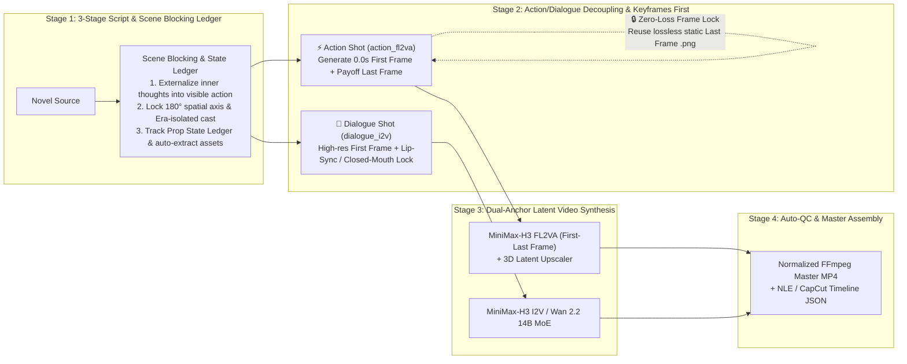

# 🎬 DramaForge Studio — Keyframe-First & FL2VA AI Short-Drama Production Workbench

<div align="center">

**English | [简体中文](README.zh-CN.md)**

[](LICENSE)
[](https://www.python.org/)
[](#core-architecture--innovations)

**Stop playing random "gacha" with multi-reference video prompts.**  
An industrial-grade, **100% original & commercially friendly (MIT Licensed)** AI short-drama workbench featuring **3-Stage Scene Blocking Ledgers**, **First-Last Keyframe Anchoring (FL2VA)**, and **Zero-Loss Frame Lock Continuity**.

</div>

> [!NOTE]
> **💡 Author's Note & AI-Hacking Friendly**: This project was originally built and tuned for the author's own cloud-deployed model stack (ComfyUI + `Flux3-Klein` + `MiniMax-H3 FL2VA` / `Wan 2.2 MoE`). Because the codebase is intentionally lightweight, modular, and free of heavy framework bloat, **if you want to adapt it to other commercial APIs (e.g., Kling, Seedance, Runway, Sora, Vidu) or different local models, feel free to grab the repo and hand it over to your favorite AI coding assistant (Claude, Codex, Cursor, Gemini, etc.) to remix and customize at will!**

---

## 🎯 Why Traditional AI Drama Pipelines Fail in Production

First-generation AI short-drama tools typically follow a naive workflow: *LLM text breakdown → feeding multiple white-background character sheets & empty backgrounds directly into a Reference-to-Video (Ref2VA) model → extracting a compressed JPEG frame from the end of clip N to feed clip N+1*. In real production, this causes four critical failures:

1. **Incomplete Narrative Payoff (Actions Stop Halfway)**: Without a pixel-level ending anchor, diffusion video models drift around the opening state and fail to complete decisive physical actions (e.g., drawing a blade, slamming a contract, shutting a valve).
2. **Collage Artifacts & Anatomy Breakdown**: Forcing a video model to simultaneously composite isolated character sheets into a scene, match perspective lighting, execute large limb movements, and lip-sync dialogue results in "paper-cutout" looks and facial drift.
3. **180° Axis Violations & Era Cross-Contamination**: Without a scene-level **180° Camera Blocking Ledger** and **Era Identity Lock**, characters flip screen sides between cuts or mix modern past-life attire into ancient fantasy scenes.
4. **Photocopier Generation Loss**: Extracting H.264-compressed tail frames as reference images degrades visual sharpness into a blurry mess after 3–4 consecutive shots.

---

## ✨ Core Architecture & Innovations



### 1. 🧭 3-Stage Script Rewriting & Scene Blocking Ledger
- **Visual Externalization ("Show, Don't Tell")**: Automatically converts unfilmable internal exposition into observable physical actions and refines verbose prose into punchy spoken lines.
- **180° Spatial Blocking Axis**: Establishes explicit left-to-right screen geography for every scene (`S01`, `S02`...) so all subsequent shots inherit consistent eye-lines and screen direction.
- **Era Isolation & Prop State Ledger**: Separates identically named characters across different timelines (e.g., *Past Life Mechanic* vs. *Present Life Sect Apprentice*) and tracks every key prop from `Initial State → Interaction → Final State`.
- **Automated Asset Extraction**: Identifies new characters, environments, and props during script rewriting and populates standardized visual prompts automatically.

### 2. ⚡ Decoupled `action_fl2va` vs. 💬 `dialogue_i2v` Shots
- **Action Progression Shots (`action_fl2va`)**: Carries exactly one decisive physical progression. The engine first synthesizes both the **0.0s Opening Keyframe** and the **Completed Payoff Ending Keyframe** via `Flux3-Klein`, then locks both ends of the latent timeline in `MiniMaxH3ImageToVideo` (`fl2va`), guaranteeing 100% action completion.
- **Dialogue Performance Shots (`dialogue_i2v`)**: Focuses on micro-expressions and vocal delivery, strictly distinguishing `onscreen` lip-sync (`<d>[Chinese]...</d>`), `internal` monologue (enforcing closed-mouth constraints), and `offscreen` voiceover.

### 3. 🔗 Zero-Loss Frame Lock Continuity
- When **🔒 Frame Lock** is enabled on shot $N+1$, its opening keyframe directly binds to the **lossless static ending keyframe (`.png`)** of shot $N$ rather than a compressed video frame grab—eliminating generation loss and spatial jump-cuts.

### 4. 🖥️ Cinematic Darkroom Quad-Monitor Workbench
- Each shot card presents a 4-panel director monitor slate:
  - **`[1] First Keyframe (0.0s Anchor)`** | **`[2] Motion Arc & Acoustic Dialogue Track`** | **`[3] Last Keyframe (Payoff Anchor)`** | **`[4] Rendered Monitor & Auto-QC`**
- Seamlessly drives cloud ComfyUI (`Flux3-Klein` + `MiniMax-H3 FL2VA` + `Wan 2.2 14B MoE`), and automatically falls back to **Local HD Animatic Previz** when the cloud GPU is offline.

---

## 🚀 Quick Start

### 1. Prerequisites
- **Python**: `3.10+`
- **FFmpeg**: Used for stream Auto-QC, local animatic synthesis, and normalized master episode assembly (`brew install ffmpeg` on macOS)
- **Python Dependencies**: Only `Pillow` (zero heavy web framework bloat; built on Python's native `ThreadingHTTPServer` and SQLite WAL)

### 2. Install & Launch

```bash
# 1. Enter project directory and install dependencies
cd dramaStudio
pip install -r requirements.txt

# 2. Launch the workbench (default port: 8688)
./startStudio.sh
```

Open **`http://127.0.0.1:8688`** in your browser.  
*(On first launch, a complete dual-timeline benchmark demo project is automatically seeded so you can explore the Scene Blocking Ledger, Quad-Monitor Slate, and Frame Lock workflow immediately.)*

---

## 📂 Project Structure

```text
dramaStudio/
├── serverApp.py              # Main HTTP server & REST API (with HTTP Range video streaming)
├── startStudio.sh            # One-click startup script
├── requirements.txt          # Python package requirements
├── LICENSE                   # MIT License (free for commercial & private use)
├── core/
│   ├── studioStore.py        # SQLite WAL store, era-isolated assets, migration & demo seeder
│   ├── directorPlanner.py    # 3-Stage script rewriter, Scene Blocking Ledger & prompt compiler
│   ├── comfyBridge.py        # ComfyUI bridge (Flux3 Keyframes / H3 FL2VA / Wan2.2 MoE / Local Previz)
│   └── continuityManager.py  # Zero-loss Frame Lock, Auto-QC & normalized FFmpeg master assembly
└── web/
    ├── index.html            # Director workbench UI & dual-column script studio
    ├── studioStyle.css       # Cinematic Darkroom & Film Slate stylesheet
    └── appMain.js            # Frontend state controller, Quad-Monitor interactions & task polling
```

---

## 🔌 REST API Summary

| Method | Endpoint | Description |
| :--- | :--- | :--- |
| `GET` | `/api/status` | Server status, ComfyUI GPU availability, and global settings |
| `GET` | `/api/projects` | List all short-drama projects with episode/shot/asset counts |
| `POST` | `/api/projects` | Create a new short-drama project and initial episode |
| `GET` | `/api/projects/:id/workspace` | Load full project workspace (including `sceneLedger` and shots) |
| `POST` | `/api/episodes/:id/rewriteScript` | **Stage 1**: Novel → Scene Blocking Ledger + Prop Ledger + Asset Extraction |
| `POST` | `/api/episodes/:id/breakScript` | **Stage 2**: Compile Scene Blocking Ledger into First/Last Keyframe shots |
| `POST` | `/api/shots/:id/generateKeyframes` | Generate `first`, `last`, or `both` keyframes for a shot |
| `POST` | `/api/shots/:id/generateVideo` | Render shot video anchored by First/Last keyframes (`h3_fl2va` / `wan22_moe`) |
| `POST` | `/api/episodes/:id/syncFrameLocks` | Propagate lossless `Last Frame → Next Shot First Frame` locks across episode |
| `POST` | `/api/episodes/:id/mergeMaster` | Assemble normalized master MP4 and export timeline JSON |

---

## 📄 License

Distributed under the **[MIT License](LICENSE)**. Free for personal, studio, and commercial use.
