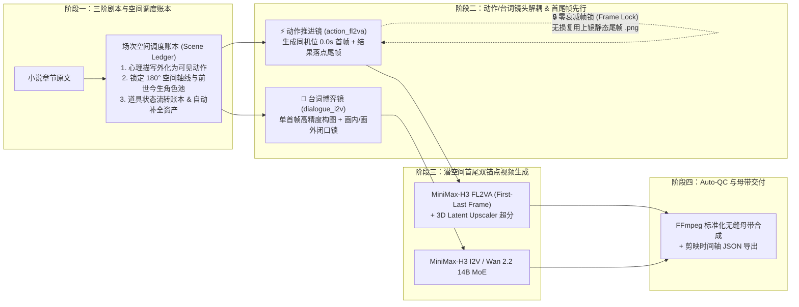

# 🎬 DramaForge Studio — 工业级首尾帧锚定 AI 短剧/漫剧生产工作台

<div align="center">

**[English](README.md) | 简体中文**

[](LICENSE)
[](https://www.python.org/)
[](#核心架构与技术突破)

**告别“盲盒抽卡、动作半途而废、镜头越轴跳戏、视频截帧糊化”**  
一套 **100% 自主版权（MIT 协议，可自由商用）** 的新一代 AI 短剧导演工作台与确定性渲染管线。

</div>

> [!NOTE]
> **💡 开源与模型适配说明**：本项目原本是作者为配合个人云端部署的大模型环境（ComfyUI + `Flux3-Klein` + `MiniMax-H3 FL2VA` / `Wan 2.2 MoE`）进行短剧工业化管线调优而打造的内部工作台。项目代码结构极度精简且无繁琐框架绑定，**如果您需要接入其他商业 API（如可灵 Kling、即梦 Seedance、Runway、Sora、Vidu 等）或本地其他开源模型，欢迎直接 Fork 并把代码喂给 AI（如 Claude / Codex / Cursor / Gemini）自由魔改适配！**

---

## 🎯 为什么我们需要重新设计 AI 短剧生产管线？

目前市面上的第一代开源 AI 短剧工具普遍采用 **“LLM 拆解流水账提示词 → 多张白底角色图/背景图直塞视频模型（Ref2VA）→ 截取压缩视频尾帧传给下一镜”** 的粗放路线，在实际工业交付中会暴露出四大致命痛点：

1. **情节演不完整（动作做一半就停）**：仅靠文字提示词写“起始状态 → 动作过程 → 结束状态”，视频扩散模型没有时间轴终点约束，只会在首帧附近随机游走，关键戏剧结果（Payoff）永远出不来。
2. **多图现场拼贴导致画质与人体结构崩坏**：让视频模型同时承担“把白底角色立绘 P 进背景 + 统一透视光影 + 大幅度肢体运动 + 中文口型同步”四项重任，必然导致纸片人贴图感、五官漂移与肢体畸变。
3. **镜头间空间断联与前世/今生串台**：缺少场次级 **180° 空间站位轴线（Camera Blocking Axis）** 和 **时空身份锁（Era Tag）**，换个景别人物左右颠倒（越轴），甚至把现代前世工装穿进修仙宗门。
4. **“复印机式”代际画质衰减**：从上一镜 H.264 压缩视频末尾截一张模糊的 `.jpg` 作为下一镜参考，连续传递 3 个镜头后画面细节彻底糊化。

---

## ✨ DramaForge Studio 的四大核心突破



### 1. 🧭 三阶影视剧本改写与“场次空间调度账本（Scene Blocking & State Ledger）”
- **心理外化（Show, Don't Tell）**：自动将小说中不可拍摄的抽象心理描写、大段回忆改写为具体可见的感官与肢体动作，并将长句书面台词精炼为短促有力的口语对白。
- **180° 空间站位轴线契约**：每场戏先定死建筑/炉口/大门与各方人物的左右站位关系，场内所有分镜自动继承该轴线，彻底杜绝镜头越轴。
- **时空防串台锁与道具状态流转**：严格隔离“前世/今生/不同时期”同名角色资产；追踪每件核心道具的 `初始状态 → 交互变化 → 最终落点`。
- **设定资产自动提取与补全**：改写剧本时自动识别新角色、新场景、新道具，生成标准化英文/中文视觉设定词并入库。

### 2. ⚡ 动作推进镜（`action_fl2va`）与 💬 台词博弈镜（`dialogue_i2v`）解耦
- **动作推进镜（FL2VA 首尾帧双锚点）**：只承载 1 个明确起止状态的物理动作。系统先通过 `Flux3-Klein` 共享同源种子生成**“0.0s 起点首帧”**与**“动作结果尾帧”**，再送入 `MiniMaxH3ImageToVideo`（`fl2va` 模型）同时锁死潜空间首尾两端，**100% 保证戏剧动作完整演完**。
- **台词博弈镜（I2V 单首帧 + 声学锁）**：专注面部微表情与台词交锋，严格区分 `onscreen`（画内对口型 `<d>[Chinese]...</d>`）、`internal`（内心独白，强制注入双唇紧闭硬约束）与 `offscreen`（场外音）。

### 3. 🔗 零画质衰减的“帧锁链（Frame Lock）”
- 当相邻镜头开启 **“🔒 帧锁：承接上镜尾帧”** 时，下一镜的首帧直接**无损绑定上一镜的高清静态尾帧原图（`.png`）**，不再从压缩视频中截帧，实现真正的零代际画质损耗与像素级动作接力。

### 4. 🖥️ 影视工业暗房级“四联导演监视器（Quad-Monitor Slate）”
- 专为短剧导演打造的暗黑调色室工作台，每个镜头直观并列呈现：
  - **`[1] 首帧锚点 (0.0s 起点)`** | **`[2] 戏剧动作弧线 & 台词声学轨`** | **`[3] 尾帧锚点 (结果落点)`** | **`[4] 镜头成片监视器 & Auto-QC`**
- 支持云端 ComfyUI（`Flux3-Klein` + `MiniMax-H3 FL2VA` + `Wan 2.2 14B MoE`）实时渲染；当云端显卡未开机时，自动切换为**本地高清动态分镜预演（Animatic Previz）**，随时离线审片与合成整集母带。

---

## 🚀 快速开始

### 1. 环境要求
- **Python**：3.10 及以上版本
- **FFmpeg**：用于音视频流质检（Auto-QC）、动态分镜预演与整集母带标准化拼接（macOS 可通过 `brew install ffmpeg` 安装）
- **Python 依赖**：仅需 `Pillow`（零臃肿框架依赖，内置 SQLite 与多线程 HTTP 服务）

### 2. 安装与一键启动

```bash
# 1. 进入项目目录并安装轻量依赖
cd dramaStudio
pip install -r requirements.txt

# 2. 一键启动导演工作台（默认端口 8688）
./startStudio.sh
```

启动后在浏览器访问：**`http://127.0.0.1:8688`**  
（首次启动将自动加载内置的《风雪孤驿 (Demo)》公共演示项目，开箱即可体验完整的三阶剧本与首尾关键帧管线）。

---

## ⚙️ 模型与云端算力配置

点击工作台右上角 **“⚙️ 引擎设置”** 即可在线配置：

| 模块 | 支持引擎 / 接口 | 用途说明 |
| :--- | :--- | :--- |
| **分场剧本与调度账本** | DeepSeek / OpenAI 兼容接口 + 内置确定性戏剧规则引擎 | 小说心理外化、180° 轴线账本建立、资产提取与分镜规划 |
| **首尾关键帧合成** | ComfyUI `Flux3-Klein` (`flux3_image_klein_sd_bf16`) | 生成同机位、同光照、同服装的高清首帧与尾帧锚点图 |
| **首尾帧音画视频引擎** | ComfyUI `MiniMax-H3 FL2VA` (`minimax_h3_fl2va` + `3D Latent Upscaler`) | 潜空间首尾双锚点驱动 + 原生中文对白口型同步与空间音效 |
| **双专家高清视频引擎** | ComfyUI `Wan 2.2 14B MoE` (`HIGH` + `LOW` 双专家) | 高噪宏观运镜 + 低噪微观面部材质精修 |

---

## 📂 项目目录结构

```text
dramaStudio/
├── serverApp.py              # 主服务端入口与 REST API 路由 (支持 HTTP Range 视频流)
├── startStudio.sh            # 一键启动脚本
├── requirements.txt          # Python 依赖声明
├── LICENSE                   # MIT 开源许可证（支持自由商业化）
├── core/
│   ├── studioStore.py        # SQLite 数据库管理、资产防串台入库、历史数据迁移与内置演示项目
│   ├── directorPlanner.py    # 三阶剧本改写、场次空间调度账本 (Scene Ledger) 与多引擎 Prompt 编译器
│   ├── comfyBridge.py        # ComfyUI 桥接器 (Flux3 双关键帧 / H3 FL2VA / Wan2.2 MoE / 本地 Previz 兜底)
│   └── continuityManager.py  # 零衰减帧锁传递 (Frame Lock)、Auto-QC 视频质检与 FFmpeg 母带标准化合成
└── web/
    ├── index.html            # 导演工作台主界面与三阶剧本双栏工作台
    ├── studioStyle.css       # 影视工业暗房级调色室样式表 (Cinematic Darkroom & Film Slate)
    └── appMain.js            # 前端状态管理、四联监视器交互与后台任务轮询
```

---

## 🔌 核心 REST API 一览

| 方法 | 路径 | 说明 |
| :--- | :--- | :--- |
| `GET` | `/api/status` | 获取服务状态、云端 ComfyUI GPU 在线状态与全局配置 |
| `GET` | `/api/projects` | 获取所有短剧项目列表及剧集/分镜/资产统计 |
| `POST` | `/api/projects` | 创建新短剧项目与初始剧集 |
| `GET` | `/api/projects/:id/workspace` | 获取指定项目完整工作台数据（含 `sceneLedger` 场次账本与四联分镜） |
| `POST` | `/api/episodes/:id/rewriteScript` | **阶段一**：小说原文 → 影视化分场剧本 + 180° 空间调度账本 + 自动提取补全资产 |
| `POST` | `/api/episodes/:id/breakScript` | **阶段二**：基于场次空间调度账本编译生成首尾关键帧分镜表 |
| `POST` | `/api/shots/:id/generateKeyframes` | 生成指定镜头的首帧（`first`）、尾帧（`last`）或双关键帧（`both`） |
| `POST` | `/api/shots/:id/generateVideo` | 使用锁定的首尾关键帧渲染镜头视频（`h3_fl2va` / `wan22_moe`） |
| `POST` | `/api/episodes/:id/syncFrameLocks` | 一键同步全集相邻镜头的“上一镜高清尾帧 → 下一镜首帧”无损帧锁 |
| `POST` | `/api/episodes/:id/mergeMaster` | 标准化音频采样率与画幅，无缝拼接整集母带 MP4 并导出剪映时间轴 JSON |

---

## 📄 开源许可证 (License)

本项目完全独立编写，采用 **[MIT License](LICENSE)** 开源协议。您可以自由地将其用于个人创作、工作室生产、私有化部署或商业化产品开发。
